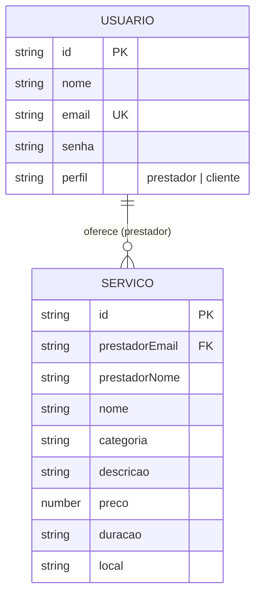

# SAS - Sistema de Agendamento de Serviços

> Plataforma web que conecta **prestadores de serviços** a **clientes** que precisam contratá-los.

Projeto Integrador do curso de **Tecnologia em Análise e Desenvolvimento de Sistemas** do **Centro Universitário Senac – Santo Amaro**, disciplina *Análise de soluções integradas para organizações* (2026).

---

## Sumário

1. [Sobre o projeto](#sobre-o-projeto)
2. [Funcionalidades](#funcionalidades)
3. [Tecnologias utilizadas](#tecnologias-utilizadas)
4. [Estrutura de arquivos](#estrutura-de-arquivos)
5. [Como executar](#como-executar)
6. [Como usar](#como-usar)
7. [Modelo de dados](#modelo-de-dados)
8. [Como o código está organizado](#como-o-código-está-organizado)
9. [Limitações conhecidas](#limitações-conhecidas)
10. [Próximos passos](#próximos-passos)
11. [Equipe](#equipe)

---

## Sobre o projeto

Muitos pequenos negócios e profissionais autônomos organizam seus atendimentos em cadernos ou aplicativos de mensagens, o que gera conflitos de horário e perda de clientes. Do outro lado, quem precisa contratar um serviço (eletricista, diarista, manicure etc.) tem dificuldade para comparar profissionais, preços e disponibilidade.

O **SAS** centraliza essa relação em uma única plataforma com dois perfis de usuário:

- **Prestador de serviços:** cria sua conta, cadastra os serviços que oferece (com preço, duração e local de atendimento) e acompanha o que está publicado.
- **Cliente:** cria sua conta, navega pelo catálogo de serviços disponíveis e pesquisa pelo nome do serviço.

Esta versão é o **MVP (Produto Mínimo Viável)**: roda totalmente no navegador, sem servidor, e valida os principais fluxos de navegação definidos nas personas e jornadas do projeto (Mariana, a cliente, e Pedro, o prestador).

## Funcionalidades

### Implementadas

- [x] Tela inicial com opções de **Entrar** e **Cadastre-se**
- [x] Escolha de perfil no cadastro (**Prestador** ou **Cliente**)
- [x] Cadastro de usuário (nome, e-mail e senha com no mínimo 6 caracteres)
- [x] Bloqueio de e-mails duplicados
- [x] Login com e-mail e senha
- [x] Painel do prestador com saudação personalizada
- [x] Cadastro de serviços (nome, categoria, descrição, preço, duração e local de atendimento)
- [x] Listagem dos serviços do próprio prestador
- [x] Painel do cliente com catálogo de todos os serviços cadastrados
- [x] Busca de serviços por nome, com atualização enquanto o usuário digita
- [x] Exibição de preço formatado em reais (R$) e nome do prestador em cada serviço
- [x] Saída da conta (logout)
- [x] Exclusão de conta (para prestadores, os serviços cadastrados também são removidos)
- [x] Persistência dos dados no navegador (via `localStorage`)
- [x] Layout responsivo, pensado para uso em celular

### Em desenvolvimento

Os botões abaixo já existem na interface, mas exibem apenas um aviso de "em desenvolvimento":

- [ ] Agendamentos (prestador e cliente)
- [ ] Meu perfil (prestador e cliente)
- [ ] Favoritos (cliente)

## Tecnologias utilizadas

| Camada | Tecnologia | Uso |
| --- | --- | --- |
| Front-end | **HTML5** | Estrutura das telas (SPA de arquivo único) |
| Front-end | **CSS3** | Estilização e layout (Flexbox e CSS Grid) |
| Front-end | **JavaScript (ES6+, puro)** | Navegação entre telas, regras de negócio e manipulação do DOM |
| Back-end | *Não utilizado nesta versão* | As regras de negócio rodam no próprio navegador |
| Banco de dados | **`localStorage`** (Web Storage API) | Armazenamento de usuários e serviços em formato JSON |

Não há frameworks, bibliotecas externas, gerenciador de pacotes (npm) nem etapa de build.

## Estrutura de arquivos

```
sas/
├── index.html        # Estrutura de todas as telas
├── css/
│   └── style.css     # Estilos da aplicação
└── js/
    └── app.js        # Lógica da aplicação
```

> **Importante:** o `index.html` carrega os arquivos em `css/style.css` e `js/app.js`. Mantenha essas pastas exatamente com esses nomes, ou a página abrirá sem estilo e sem funcionar.

## Como executar

Não é necessário instalar nada.

1. Baixe ou clone o repositório:
   ```bash
   git clone <URL-DO-REPOSITORIO>
   cd sas
   ```
2. Abra o arquivo `index.html` em qualquer navegador moderno (Chrome, Edge, Firefox, Safari).

**Opcional:** para rodar com um servidor local (por exemplo, usando a extensão *Live Server* do VS Code ou o Python):

```bash
python -m http.server 8000
# depois acesse http://localhost:8000
```

## Como usar

### Fluxo do prestador

1. Na tela inicial, clique em **Cadastre-se** e escolha **Prestador de serviços**.
2. Preencha nome, e-mail e senha e clique em **Finalizar cadastro**.
3. No painel, clique em **Cadastrar serviço** e preencha o formulário.
4. Em **Meus serviços**, confira os serviços publicados.

### Fluxo do cliente

1. Na tela inicial, clique em **Cadastre-se** e escolha **Cliente**.
2. Preencha nome, e-mail e senha e clique em **Finalizar cadastro**.
3. No painel, veja a lista de **Serviços disponíveis** ou digite no campo de busca para filtrar por nome.

> Para testar o fluxo completo, cadastre primeiro uma conta de prestador com alguns serviços, saia da conta e depois crie uma conta de cliente.

## Modelo de dados

Os dados ficam no `localStorage` do navegador, em duas chaves que armazenam listas em JSON:

| Chave | Conteúdo |
| --- | --- |
| `sasUsuarios` | Lista de usuários cadastrados |
| `sasServicos` | Lista de serviços cadastrados pelos prestadores |



**Observações:**

- Apenas usuários com perfil `prestador` podem ter serviços.
- O e-mail é único e funciona como identificador de login.
- Ao apagar a conta de um prestador, todos os registros de `SERVICO` ligados ao seu e-mail são removidos.

**Categorias disponíveis:** Beleza e estética, Limpeza, Manutenção, Tecnologia, Educação, Saúde e bem-estar, Outros.

**Locais de atendimento:** no estabelecimento do prestador, na residência do cliente, online ou a combinar.

## Como o código está organizado

### `index.html`

Aplicação de página única: todas as telas estão no mesmo arquivo como `<section>`, e apenas uma fica visível por vez (as demais recebem a classe `oculto`).

| Seção (`id`) | Descrição |
| --- | --- |
| `telaInicial` | Boas-vindas, botões Entrar e Cadastre-se |
| `telaLogin` | Formulário de login |
| `telaPerfil` | Escolha entre prestador e cliente |
| `telaCadastro` | Formulário de cadastro de usuário |
| `painelPrestador` | Painel do prestador e lista dos seus serviços |
| `telaCadastroServico` | Formulário de novo serviço |
| `painelCliente` | Painel do cliente, busca e catálogo |

### `css/style.css`

Estilos organizados por componente: layout geral, botões, formulários, painéis do prestador e do cliente, e cartões de serviço. A paleta principal usa azul (`#2878c8`) sobre fundo claro.

### `js/app.js`

| Bloco | Funções principais |
| --- | --- |
| Dados do sistema | Carrega `usuarios` e `servicos` do `localStorage` |
| Funções gerais | `salvarUsuarios()`, `salvarServicos()`, `mostrarTela(id)`, `abrirPainelUsuario()` |
| Exclusão de conta | `apagarConta()` |
| Serviços do prestador | `atualizarListaServicos()` |
| Catálogo do cliente | `atualizarCatalogoCliente(filtro)` |
| Eventos | Navegação, cadastro, login, logout, cadastro de serviços e busca |

A navegação funciona assim: `mostrarTela(id)` oculta todas as telas da lista `telas` e exibe apenas a desejada.

## Limitações conhecidas

Por ser um MVP local e de caráter acadêmico, a versão atual possui limitações que **devem ser resolvidas antes de qualquer uso real**:

- **Sem back-end:** os dados ficam apenas no navegador do usuário. Não são compartilhados entre dispositivos nem entre usuários diferentes. Um serviço cadastrado em um computador não aparece para clientes em outro.
- **Senhas em texto puro:** as senhas são salvas sem criptografia no `localStorage`. Em uma versão real, devem ser tratadas no servidor com *hash* (por exemplo, bcrypt).
- **Sem autenticação real:** a "sessão" existe apenas na memória da página e é perdida ao recarregá-la (o usuário precisa entrar de novo).
- **Dados apagáveis:** limpar os dados do navegador apaga todos os usuários e serviços.
- **Agendamentos, perfil e favoritos** ainda não foram implementados.
- **Não é um aplicativo móvel nativo:** é uma página web responsiva.

## Próximos passos

- Implementar a **API REST** (back-end) com banco de dados relacional ou NoSQL e autenticação segura
- Criar o fluxo de **agendamento** (escolha de data e horário, confirmação, cancelamento)
- Adicionar **disponibilidade de horários** do prestador para evitar conflitos e overbooking
- Implementar **avaliações** de prestadores, **favoritos** e **perfil** do usuário
- Incluir **notificações** de novos agendamentos
- Filtros de busca por categoria, preço e local

## Equipe

- Alexandre Aguiar Leite
- Luana Alves dos Santos
- Carlos Henrique Guimarães Pinheiro
- Ana Milena Queiroz Silva
- Marivaldo Nobre Neto
- Linete Oliveira Dantas
- Denisson Ramos dos Santos
- Davi Staricoff

**Orientador:** Prof. Anderson Clayton

---

📍 Centro Universitário Senac – Santo Amaro · São Paulo · 2026
